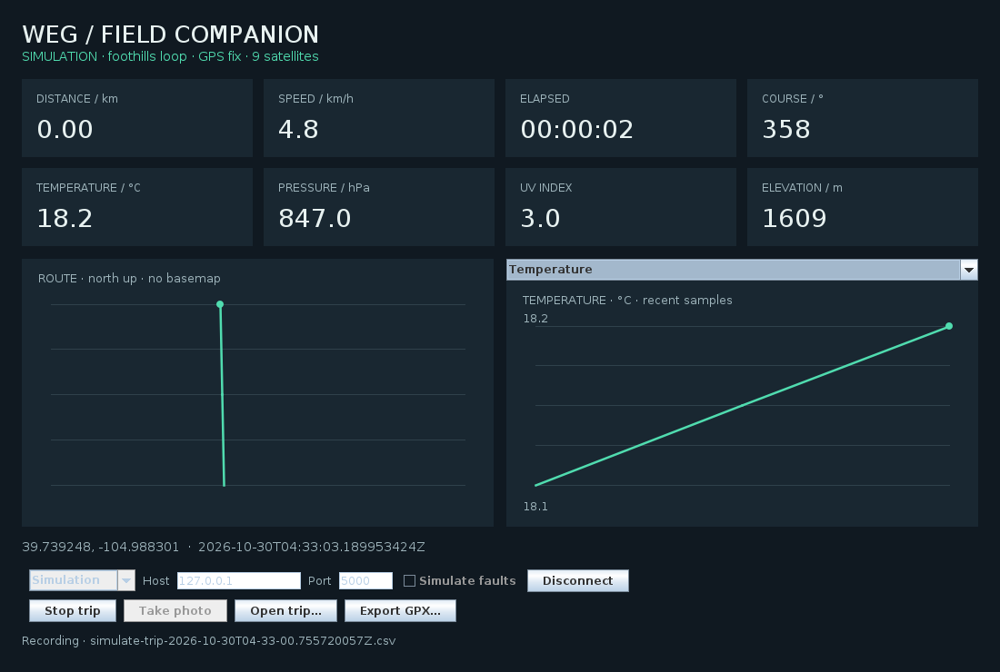
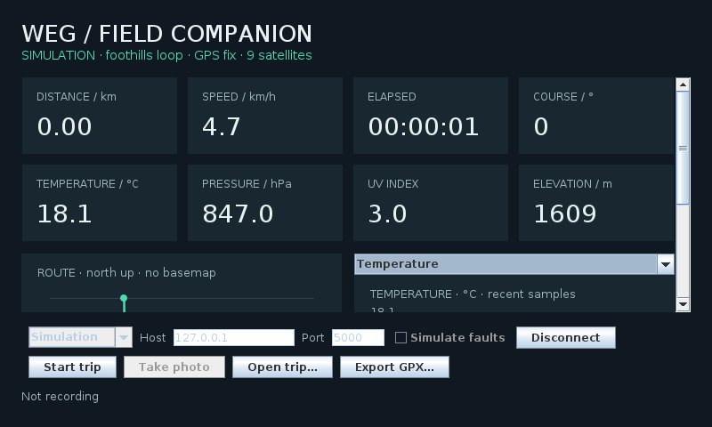

# WEG · Wearable Excursion Gear

WEG was originally developed as a college capstone project in embedded systems.
It has since been modernized into an offline excursion recorder.
Run a simulated walk on your computer, replay a saved trip, or connect the original
PIC sensor board through a Raspberry Pi. No cloud account or network is needed for
simulation, recording, playback, route plots, or GPX export.

## Screenshots

Actual screenshots running simulated sensor data.

**Desktop dashboard — 1100×740**



**Compact layout — 800×480**, with scrolling for the charts.



## Start here

Requires a **JDK 17 or newer** and Bash. The graphical dashboard also needs the
JRE desktop/AWT libraries and a display; a headless-only Java installation can run
`--headless` mode. Set `JAVA_HOME` to select a project-local full JDK. The desktop app has no third-party runtime
libraries and builds without downloads, Maven, or NetBeans.

```bash
./scripts/run.sh
```

The dashboard starts in **simulation**. It includes distance, speed, elapsed time,
course over ground, temperature, pressure, UV, elevation, a route trace, and
selectable temperature/pressure history. Use **Start trip** to record, **Stop trip**
to save, **Open trip…** to replay, and **Export GPX…** to export a route.

```bash
./scripts/run.sh --faults                         # GPS loss and disconnect recovery
./scripts/run.sh --headless --samples 10          # Record without a display
./scripts/run.sh --replay tests/fixtures/simulated-walk.csv       # Open a recorded trip
./scripts/run.sh --mode live --host 127.0.0.1 --port 5000
./scripts/run.sh --help
```

Live mode requires pressing **Connect**. Playback reads one row per second and
retains the recorded timestamps. Trips default to `~/.weg/trips`; change the
location with `--output DIRECTORY`. Simulation trips are for demonstration.
Simulation mode requires no Raspberry Pi or sensor board.

## Raspberry Pi and original hardware

The bridge builds with a C11 compiler and Make on Linux; it does **not** depend on
WiringPi or run the Java application as root.

```bash
make -C uart-serial-ipc
./uart-serial-ipc/DamCommSocket --device /dev/serial0 --once
./uart-serial-ipc/DamCommSocket --device /dev/serial0
```

The serial device must already exist and be accessible to your user. Configure
the Pi's UART and disable its serial console using the supported OS configuration
tools. Read [hardware setup](docs/hardware.md) before connecting the original board.
Do not copy the archived 2016 boot files onto a modern installation.

## Develop and test

```bash
./scripts/build.sh
./scripts/test.sh
```

Tests need Python 3 and a C compiler in addition to Java. They exercise parsing,
GPS mathematics, missing measurements, recording/replay/export, socket deadlines,
and the real C bridge against a pseudo-terminal. They do not flash firmware.

- [Architecture and data formats](docs/architecture.md)
- [Hardware setup and validation limits](docs/hardware.md)
- [Changes and migration](docs/migration.md)
- [Development record](development/modernization/README.md)
- [Original installation notes — historical only](docs/legacy-install.md)

The source under `DamCommPIC.X/` targets the original PIC24F16KA101. Firmware changes
require XC16/MPLAB and physical-board verification before deployment. Bundled
historical JARs and `lib/tangram-es/` are retained for provenance and are not used
by the new build. Build fresh artifacts with the scripts above.

Licensed under Apache-2.0; see [LICENSE](LICENSE). Third-party historical sources
retain their own license notices.
